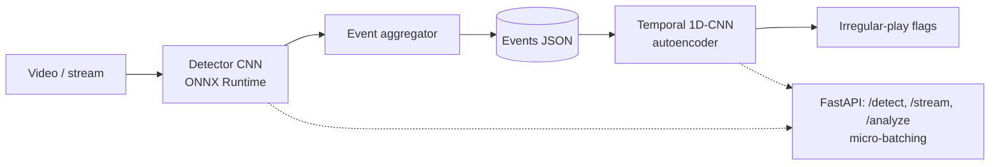

# video_event_detection

Real-time in-game event detection, low-latency model serving, and temporal analysis that flags
irregular play, in one pipeline: **video -> events -> irregular-play flags**.



> **Status:** all code, tests and CI config are written, but the models have **not been trained,
> benchmarked or run end to end yet**. The results section below is a template to fill from
> `make all` and `make bench`; nothing there is a measured result.

## Data

Real VODs are licence-encumbered and unlabelled, so `common/sim.py` renders seeded arena matches
(kill-feed banners, round start/end banners, distractor HUD) to mp4 with exact event labels and
injected irregular play (kill bursts, kill droughts). This makes the project reproducible but much
easier than a real HUD; see [docs/architecture.md](docs/architecture.md) for the trade-off and
all design decisions.

Event schema: `{"timestamp": 12.4, "event_type": "kill", "confidence": 0.98, "bbox": [x1,y1,x2,y2], "team": "red"}`.

## Run it

```bash
make install        # venv + CPU PyTorch
make data           # 100 matches -> data/raw, data/annotations
make train-detector # detection/results.json: confusion matrix, per-class and event-level P/R
make infer          # detector -> data/events/*.json
make train-temporal # temporal/results.json: AUROC, P/R, per-anomaly-type recall
make export         # ONNX + meta.json -> models/
make bench          # PyTorch vs ONNX Runtime latency
make serve          # http://localhost:8000
make test
```

Docker (inference only, no PyTorch):

```bash
docker build -f serving/Dockerfile -t video-event-serving .
docker run -p 8000:8000 -v $PWD/models:/app/models video-event-serving
```

Stream a clip to the service: open `ws://localhost:8000/stream?fps=10`, send each frame as a
binary JPEG, and read one JSON reply per frame (`events`, `anomalies`, `latency_ms`).

## Layout

| Path | Role |
|---|---|
| `common/` | event schema, video ingestion, synthetic game generator |
| `detection/` | `EventNet` CNN, training, event aggregation, inference CLI, metrics |
| `temporal/` | event stream -> windows, 1D-CNN autoencoder, training and evaluation |
| `serving/` | FastAPI app, micro-batcher, streaming pipeline, ONNX export, Dockerfile |
| `benchmarks/` | p50/p95/p99 latency and throughput harness |
| `notebooks/eda.ipynb` | exploratory analysis of events and anomalies |

## Results (to fill after running)

| Stage | Metric | Value |
|---|---|---|
| Detection (held-out matches 40-49) | event F1 per type (±0.5 s) | _not run_ |
| Temporal (held-out matches 70-99) | window AUROC, model vs. kill-burst baseline | _not run_ |
| Serving, CPU | p50 / p99 per frame, PyTorch vs ONNX | _not run_ |

## Limitations and next steps

- Synthetic footage; real-game accuracy is untested.
- `bbox`/`team` come from a fixed HUD template.
- CPU only; TensorRT, Azure Container Apps deployment, a Java/C# client, and a MediaPipe pose
  signal into the temporal model are natural extensions.
