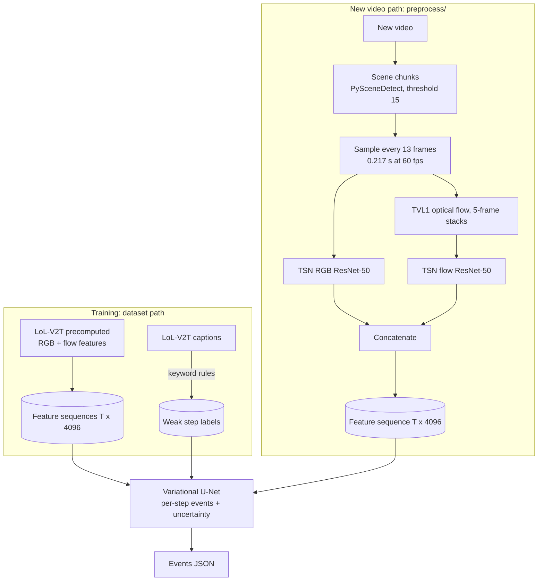

# video_event_detection

Event detection on League of Legends broadcast video. Labels come from the commentary, the
detector is a variational U-Net that labels every time step with an uncertainty estimate, and a
preprocessing module reproduces the dataset's feature extraction so new video can be used.



> **Status:** all code, tests and CI config are written and the unit tests pass, but no model has
> been trained and no extracted features have been checked against the dataset. The results
> table below is a template, not measured results.

## Data

[LoL-V2T](https://tsunehiko.github.io/lol-v2t/) (Tanaka and Simo-Serra, CVPR Workshops 2021):
9,723 League of Legends Worlds clips (76 h) with 62,677 timestamped commentary sentences, and
precomputed RGB and optical-flow features per clip (the raw video is not distributed). It has no
event labels, so **each step of a clip is labelled from the captions** with keyword rules:
`kill`, `objective`, `teamfight`, or background. These labels are weak: commentary lags the
action and keywords misfire, so results measure agreement with the commentary, not with the game.
The dataset page states no licence: download it yourself and do not redistribute it.

A clip is a `(T, 4096)` sequence: T time steps, each one sampled frame turned into a 2048-number
ResNet-50 RGB feature plus a 2048-number flow feature. T varies (109 for a 23.6 s clip).

How the features were made, read from the dataset's own code:
[docs/feature_extraction.md](docs/feature_extraction.md). In short: one step every 13 frames
(0.217 s at 60 fps, which explains 109 steps where the paper's 0.26 s predicts 91), TSN ResNet-50
checkpoints trained on **ActivityNet** (not the plain Kinetics-400 models the paper mentions),
TVL1 flow in 5-frame stacks, and clips cut at PySceneDetect scene changes.

## Model

`VariationalUNet` (`detection/model.py`), 1D over time:

- encoder with 2 stride-2 levels and skip connections; bottleneck outputs `mu`, `log_var` and
  samples `z`;
- **classification head**: decoder from `z` with skips -> per-step logits
  (`background | kill | objective | teamfight`);
- **reconstruction head**: rebuilds the input features from `z` alone (no skips), so the latent
  must carry information instead of being bypassed by the skips;
- loss = masked class-weighted cross-entropy + lambda * reconstruction MSE + beta * KL, with
  beta ramped up over the first epochs; padding is masked out of every term;
- uncertainty: sample `z` several times and take the spread of the predictions.

Ablations, trained and reported the same way: the U-Net without the variational parts
(`--arch unet`) and the earlier dilated-convolution net (`--arch dilated`). If the variational
parts do not help, the results should say so. Details: [docs/architecture.md](docs/architecture.md).

## Run it

Dependencies are managed with [uv](https://docs.astral.sh/uv/) and pinned in `uv.lock`
(CPU-only PyTorch from the PyTorch index). Every `make` target runs through `uv run`.

```bash
make install         # uv sync: .venv with CPU PyTorch, serving deps and the dev group
make install-gpu     # then CUDA PyTorch + onnxruntime-gpu (untested); run with RUN="uv run --no-sync"
make data            # LoL-V2T annotations + features into data/lolv2t (~16 GB)
make train-detector  # models/detector.pt, detection/results.json
make ablation        # detection/results_unet.json, detection/results_dilated.json
make export          # ONNX + meta.json -> models/
make bench           # model only: PyTorch vs ONNX Runtime
make serve           # http://localhost:8000 (player at /player)
make test
```

Annotations alone (3 MB) are enough for the tests' data loaders and the EDA notebook:
`uv run python -m data.scripts.download_lolv2t`. After changing dependencies in
`pyproject.toml`, run `make lock` (`uv lock`) and commit `uv.lock`. `scenedetect` depends on
`opencv-python`, whose `cv2` would shadow the contrib build that TVL1 needs, so `pyproject.toml`
tells uv to leave it out.

### New video

```bash
make install-extract   # uv sync --all-extras: + torchvision, OpenCV contrib (TVL1), PySceneDetect
uv run python -m preprocess.extract match.mp4 --out features.npy --backend torch
uv run python -m detection.infer --features features.npy --duration 23.6 --samples 16
```

`preprocess.extract` writes one `.npy` per scene chunk plus a `.json` index with each chunk's
start time. It loads the dataset's mmaction2 checkpoints (downloaded on first use). Two backends:

- `--backend mmaction2` (default) runs mmaction2 0.x's own backbone code, as the dataset did. It
  needs `mmaction2==0.24.1` and mmcv-full 1.x, which only have CPU wheels for older PyTorch
  (Python 3.10 + `torch==1.13.1`). That cannot share `uv.lock` (torch >= 2.2), so it lives in
  its own environment: `serving/Dockerfile.full` installs it with `uv pip`.
- `--backend torch` loads the same weights into torchvision's ResNet-50. It is lighter, but
  **unverified**: only trust it once it passes the acceptance check below.

The mmaction2 checkpoints carry non-tensor metadata, so loading them needs `--trust-checkpoint`;
by default the loader only accepts plain tensors.

**Acceptance check (manual, not run yet):** re-extract dataset clips from their source videos and
compare with the shipped features; the target is cosine similarity above 0.99 at every step.
`uv run python -m preprocess.verify --help` describes the inputs. The source videos may have been
removed or changed since 2020, so the check may only cover some clips.

Known gaps against the dataset: the dataset dropped non-gameplay scenes with a classifier whose
weights are not published, so every scene is kept here; and the fork of mmaction2 it used is
unpublished, so a few details (flow indices at the end of a clip) follow the public mmaction2 0.x
script.

## Serving

```bash
docker build -f serving/Dockerfile -t video-event-serving .            # features only, no PyTorch
docker build -f serving/Dockerfile.full -t video-event-serving-full .  # + video input (untested)
docker run -p 8000:8000 -v $PWD/models:/app/models video-event-serving
```

```bash
curl -F file=@clip_features.npy "localhost:8000/detect_features?duration=23.6&samples=16"
curl -F file=@match.mp4 "localhost:8000/detect_video?chunking=scene"   # full image only
```

- `POST /detect_features`: a `(T, D)` float32 `.npy`. Returns events
  (`{"timestamp", "event_type", "confidence", "uncertainty"}`); `samples > 1` also returns
  per-step uncertainty.
- `POST /detect_video`: a video file. It is chunked and preprocessed, then each chunk is
  detected; timestamps are relative to the start of the full video. The slim image returns 501.
- `GET /player` (also `/`): a browser player for inference results. Pick a video, run
  detection (full image) or load a saved events JSON (any image), then play it: events are
  marked on a timeline over the scene chunks, the current event and its confidence and
  uncertainty show on the video, and clicking a marker or a table row seeks to it. Results can
  be saved as JSON. The page has no external assets. Browsers play H.264 MP4 or VP9 WebM; for
  other codecs the page says so, and detection still runs on the server.

**Latency.** The low-latency figures apply to the model only. Preprocessing (TVL1 flow and two
ResNet-50 passes per step) dominates `/detect_video`. On a 4-vCPU Xeon development box
(`make bench` / `make bench-preprocess`, untrained weights of the real size, which have the same
cost):

| Stage | Measure | Value |
|---|---|---|
| Model, ONNX Runtime, 110-step clip | p50, deterministic / 16 samples | 1.4 ms / 26 ms |
| Model, PyTorch, 110-step clip | p50, deterministic / 16 samples | 2.5 ms / 57 ms |
| Preprocessing, 60 fps video | compute time per second of video | 5.7 s (92% TVL1 flow) |

So on CPU a 23.6 s clip takes about two minutes to preprocess and milliseconds to detect.
TVL1 on a GPU (or a faster flow method, once verified) is the obvious next step.

## Layout

| Path | Role |
|---|---|
| `common/` | event schema, LoL-V2T loader (safe pickle reader), caption-derived labels |
| `preprocess/` | video -> features: chunking, sampling, TVL1 flow, TSN networks, CLI, acceptance check |
| `detection/` | variational U-Net and ablations, training, event aggregation, inference CLI, metrics |
| `serving/` | FastAPI app, browser player (`static/player.html`), ONNX pipeline, ONNX export, Dockerfiles |
| `benchmarks/` | model and preprocessing latency, HTTP load |
| `data/scripts/` | LoL-V2T downloader |
| `notebooks/eda.ipynb` | exploratory analysis of the annotations and the keyword rules |

## Results (to fill after running)

| Model | Metric (LoL-V2T test split, weak labels) | Value |
|---|---|---|
| Variational U-Net | event F1 per type (+-3 s) | _not run_ |
| Variational U-Net | mean sampled std, correct vs wrong steps | _not run_ |
| U-Net, no variational parts | event F1 per type (+-3 s) | _not run_ |
| Dilated conv net | event F1 per type (+-3 s) | _not run_ |
| Preprocessing | cosine similarity to shipped features | _not run_ |

## Limitations and next steps

- Labels are derived from commentary (noisy); a small hand-labelled subset would give a trustworthy
  evaluation.
- The extractor has not yet been checked against the shipped features, and the dataset's scene
  filter cannot be reproduced.
- Training and feature extraction need a stronger machine than the development box.
- No irregular-play detection (LoL-V2T has no such labels); `bbox` is never filled.
