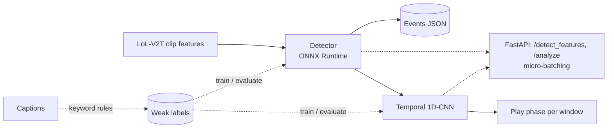

# video_event_detection

Event detection on League of Legends broadcast clips with labels taken from the commentary,
low-latency model serving, and a temporal model that classifies the play phase.



> **Status:** all code, tests and CI config are written, but nothing has been trained, benchmarked
> or run end to end yet. The results table below is a template: nothing in it is a measured result.

## Data

[LoL-V2T](https://tsunehiko.github.io/lol-v2t/) (Tanaka and Simo-Serra, CVPR Workshops 2021):
9,723 League of Legends Worlds clips (76 h) with 62,677 timestamped commentary sentences, and
precomputed RGB and optical-flow features per clip (the raw video is not distributed). It has no
event labels, so **each sequence of frames is labelled from the captions** with keyword rules:
`kill`, `objective`, `teamfight`, or background. These labels are weak: commentary lags the
action and keywords misfire, so results measure agreement with the commentary, not with the game.
The dataset page states no licence: download it yourself and do not redistribute it. Details and
trade-offs: [docs/architecture.md](docs/architecture.md).

Event schema: `{"timestamp": 12.4, "event_type": "kill", "confidence": 0.98}`.

## Run it

```bash
make install         # venv + CPU PyTorch
make install-gpu     # venv + CUDA PyTorch + onnxruntime-gpu (untested)
make data            # LoL-V2T annotations + features into data/lolv2t (~16 GB)
make train-detector  # detection/results.json: step confusion matrix, event-level P/R/F1
make train-temporal  # temporal/results.json: phase accuracy/macro-F1 vs a no-learning baseline
make export          # ONNX + meta.json -> models/
make bench           # PyTorch vs ONNX Runtime latency
make serve           # http://localhost:8000
make test
```

Annotations alone (3 MB) are enough for the tests' data loaders and the EDA notebook:
`python -m data.scripts.download_lolv2t`.

Docker (inference only, no PyTorch):

```bash
docker build -f serving/Dockerfile -t video-event-serving .
docker run -p 8000:8000 -v $PWD/models:/app/models video-event-serving
```

```bash
curl -F file=@clip_features.npy "localhost:8000/analyze?duration=23.5"   # features (T, D) float32
```

## Layout

| Path | Role |
|---|---|
| `common/` | event schema, LoL-V2T loader (safe pickle reader), caption-derived labels |
| `detection/` | `FeatureEventNet`, training, event aggregation, inference CLI, metrics |
| `temporal/` | detector output -> windows, `PhaseNet` 1D-CNN, training and evaluation |
| `serving/` | FastAPI app, micro-batcher, pipeline, ONNX export, Dockerfile |
| `benchmarks/` | p50/p95/p99 latency and throughput harness |
| `data/scripts/` | LoL-V2T downloader |
| `notebooks/eda.ipynb` | exploratory analysis of the annotations and the keyword rules |

## Results (to fill after running)

| Stage | Metric | Value |
|---|---|---|
| Detector, LoL-V2T test split, weak labels | event F1 per type (±3 s) | _not run_ |
| Temporal, LoL-V2T test split, weak labels | phase macro-F1, model vs baseline | _not run_ |
| Serving, CPU | p50 / p99 per clip, PyTorch vs ONNX | _not run_ |

## Limitations and next steps

- Labels are derived from commentary (noisy); a small hand-labelled subset would give a trustworthy
  evaluation.
- Works on precomputed features, not raw frames; there is no streaming endpoint.
- No irregular-play detection (LoL-V2T has no such labels).
- TensorRT, Azure Container Apps deployment, a Java/C# client, and a pose-estimation signal are
  natural extensions.
