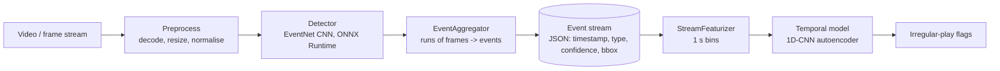

# Architecture and design decisions

## Pipeline

Serving wraps the same stages: `POST /detect` (single frame, micro-batched), `WS /stream`
(frames in, events and flags out), `POST /analyze` (finished event stream).

## ADR-1: synthetic arena footage instead of real VODs

*Context.* Real esports footage is licence-encumbered, large, and has no event labels. *Decision.*
`common/sim.py` renders a seeded top-down arena match with a HUD (kill-feed banner, round
start/end banners, distractor HUD elements) to mp4 and writes exact ground truth, including injected
irregular play. *Consequences.* Every number in this repo is reproducible and exactly labelled, and
the full pipeline runs on a laptop. The cost is realism: the task is far easier than a real game
HUD, so absolute accuracy figures do not transfer. The code paths (decode, classify, aggregate,
featurize, score, serve) are the real ones. Swapping in real footage means adding annotations in
the same JSON schema.

## ADR-2: frame classifier + event aggregator, not an object detector

Events here are HUD banners, so they are frame-level: a banner is on screen or it is not. A small
CNN classifies each frame into `background | kill | round_start | round_end`, and
`EventAggregator` turns runs of identical predictions into one event stamped at the run start
(`min_run` frames of agreement suppress single-frame blips). Banner position is then looked up from
the HUD template (`bbox`) and the kill team is read from the banner colour. For events that are
objects on the map (a goal, a player), replace `EventNet` with YOLO/RT-DETR; the aggregator and
everything downstream are unchanged.

## ADR-3: ONNX Runtime for serving, no PyTorch in the image

Both models export to ONNX with a dynamic batch axis (`serving/onnx_export.py`, which also checks
ONNX output against PyTorch). The service depends on onnxruntime, numpy and OpenCV only. Session
threads are set to 1 intra-op so concurrency comes from batching and the event loop, not from
oversubscribing cores. TensorRT is the next step when a GPU is available.

## ADR-4: micro-batching

Concurrent `/detect` calls and concurrent streams share one `MicroBatcher`: it waits up to
`max_wait_ms` (default 3 ms) or `max_batch` items, then runs one batched ONNX call in a worker
thread. This trades a few ms of queueing for throughput under load; at concurrency 1 the wait is
the cost to measure (`benchmarks/latency_bench.py http`).

## ADR-5: temporal model = reconstruction-based anomaly detection

Irregular play has no abundant labels, so the autoencoder is trained only on windows that overlap
no annotated anomaly (a "baseline of normal play"), and the window's reconstruction error is its
irregularity score. The alert threshold is the 99th percentile of scores on held-out normal
windows. Features per second: kill count, round start/end, in-round flag, time since last kill
(capped). Two anomaly types are injected: *bursts* (6-8 kills at about 1 s spacing) and
*droughts* (a 45-60 s round with no kills). A rule baseline (most kills in 8 s) is reported next to
the model; it cannot see droughts, which is the point of learning the baseline instead.

`StreamFeaturizer` is shared by training and serving, with a 0.5 s lag live so that events the
detector emits a few frames late still land in the right bin.

## ADR-6: LoL-V2T for the real-footage detector (weak labels, features only)

*Context.* [LoL-V2T](https://tsunehiko.github.io/lol-v2t/) (Tanaka and Simo-Serra, CVPRW 2021) is
the real dataset used here: 9,723 League of Legends Worlds clips (76 h), 62,677 timestamped
commentary sentences, split 6,977 / 851 / 1,895 clips. It is a *video captioning* dataset: it has
no event labels, and it ships precomputed per-clip RGB and optical-flow features
(`<clip>_rgb.pkl`, `<clip>_flow.pkl`, 2048-d per step) instead of raw video, which Riot's policy
keeps unpublished. No licence is stated on the page.

*Decision.* (1) Derive weak events from the commentary by keyword rules (`common/lolv2t.py`):
`kill`, `objective` (baron, dragon, herald, tower, inhibitor, nexus) and `teamfight`, stamped at the
start of the sentence's segment and spread over 3 s of feature steps as step labels. (2) Train
`FeatureEventNet` (`detection/seq_model.py`), a dilated 1D-conv net, to classify each feature step,
then reuse `EventAggregator` to turn step runs into events. (3) Load the third-party pickles with a
restricted unpickler that only allows numpy array reconstruction. (4) Serve it at
`POST /detect_features`, which takes a `.npy` of clip features.

*Consequences.* Real broadcast footage, but: labels are noisy (commentary lags the action, ASR text
is imperfect, keywords miss events and over-trigger on talk about events), so event precision and
recall measure agreement with the commentary, not with the game, and are not comparable to the
synthetic-data numbers. Because only features are available, the pixel CNN cannot train on it and
the service cannot ingest raw LoL video without a feature extractor. The step-to-time mapping
assumes steps are uniform over the clip duration, which is checked only by the step counts being
plausible (a 23.6 s clip has 109 steps). LoL-V2T has no irregular-play labels, so the temporal
anomaly model stays on synthetic event streams.

## Data split (synthetic matches from `make data`)

| Use | Matches |
|---|---|
| Detector train / validation | 0-39 / 40-49 |
| Temporal train (normal windows) / threshold calibration | 0-59 / 60-69 |
| Temporal test (held out) | 70-99 |

The temporal model trains on events the detector produced (`make infer`), so detector errors
propagate into it as they would in production; `--use-gt` trains on ground truth for comparison.
Matches 70-99 are never seen by either model's training.

## Limitations

- Synthetic data for the pixel detector and the temporal model; see ADR-1.
- LoL-V2T events are weak labels derived from commentary; see ADR-6.
- The kill-team and `bbox` fields come from a fixed HUD template, not a learned localiser.
- Anomaly types are the two injected ones; the model flags anything unlike normal windows, but only
  those two are measured.
- Latency numbers are CPU-only.
