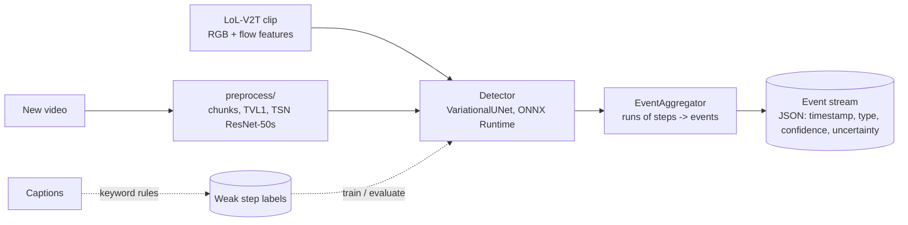

# Architecture and design decisions

## Pipeline

One model, no temporal stage. Training only uses the dataset's precomputed features; the video
path exists so new inputs land in the same feature space.

## Data: LoL-V2T and caption-derived labels

[LoL-V2T](https://tsunehiko.github.io/lol-v2t/) (Tanaka and Simo-Serra, CVPRW 2021): 9,723
League of Legends Worlds clips (76 h), 62,677 timestamped commentary sentences, split
6,977 / 851 / 1,895 clips (train / val / test). It is a video-captioning dataset. Two facts shape
the whole design:

1. **There are no event labels.** Labels come from the captions.
2. **There is no raw video.** The archives hold precomputed per-clip features
   (`<clip>_rgb.pkl`, `<clip>_flow.pkl`); Riot's policy keeps footage unpublished.

A clip is a `(T, D)` sequence of time steps (T = 109 for the 23.6 s clip inspected), not a stack
of frames: each step is one sampled frame (plus a 5-frame flow stack) turned into 2048 numbers per
modality. How the dataset made them, read from its own code, is in
[feature_extraction.md](feature_extraction.md). Two corrections to the paper came out of that:
the checkpoints are TSN ResNet-50s trained on ActivityNet (initialised from Kinetics-400), and
the step is 13 frames, i.e. 0.217 s at the 60 fps the step counts imply rather than 0.26 s.

No licence is stated on the dataset page, so the repo only downloads it
(`data/scripts/download_lolv2t.py`) and never redistributes it.

## ADR-1: labels from captions (weak supervision)

Every step gets its label from the commentary overlapping it. Keyword rules in
`common/lolv2t.py` map sentences to `kill`, `objective` (baron, dragon, herald, tower, inhibitor,
nexus) and `teamfight`. A sentence's event is stamped at the start of its segment and labels the
next 3 s of steps; where spans overlap, kill beats objective beats teamfight.

Consequences, stated plainly:

- Labels are noisy. Commentary lags the action, ASR text is imperfect, keywords miss events and
  fire on talk *about* events. Every metric here measures agreement with the commentary, not with
  what happened in the game.
- Step times assume steps are uniform over the clip: `(k + 0.5) * duration / T`. The dataset's
  sampling puts step `k` at `(6 + 13k) / fps`; for the 109-step clip the two differ by under
  0.01 s, so the assumption holds. Evaluation still uses a 3 s tolerance because of the
  commentary lag.

## ADR-2: one variational U-Net instead of detector + temporal model

The earlier design had a per-step detector and a second `PhaseNet` over windows of its outputs.
Both were fit to the same keyword labels, so the second stage mostly smoothed the first. It is
removed. One model labels every step and estimates its own uncertainty.

`VariationalUNet` (`detection/model.py`), 1D over time, `(N, D, T)` -> `(N, C, T)`:

- input normalisation from stored feature mean/std (buffers, so the ONNX model normalises its
  own input), a 1x1 projection, then 2 encoder levels (residual conv block + stride-2 conv,
  channels doubling), with skip connections;
- bottleneck: `mu` and `log_var` of a 32-dim Gaussian per latent step (one per 4 input steps),
  `z = mu + eps * sigma` (sampled in training, `eps = 0` at inference unless sampling);
- **classification head**: transposed-conv decoder from `z` with the skips -> per-step logits;
- **reconstruction head**: the same decoder shape from `z` **without** skips -> the normalised
  input features.

**Why a reconstruction head.** A VAE forces information through a small latent; U-Net skips
bypass it, so a classification-only decoder can copy the input through the skips and ignore `z`
(the KL term then pushes `z` to the prior and the "uncertainty" means nothing). The
reconstruction head sees only `z`, so `z` must encode the clip. This does not *guarantee* that
the classification decoder uses `z`; the ablation and the uncertainty report check that.

**Loss**: class-weighted cross-entropy (square-rooted inverse frequencies from a training
sample) + `lam` * reconstruction MSE + `beta` * KL. `beta` ramps linearly from 0 over
`beta_warmup_epochs`, to avoid posterior collapse early on. Defaults: `lam = 1`, `beta = 0.1`,
5 warm-up epochs (`detection/configs/default.yaml`).

**Variable length**: batches are zero-padded to the longest clip and padded steps get label
`IGNORE`. The padding is masked out of every term: cross-entropy ignores it, MSE averages over
valid steps only, KL averages over latent steps that cover at least one valid step. Inside the
network, stride-2 convolutions round up (`ceil(T / 4)` latent steps, equivalent to padding T to a
multiple of 4) and decoder outputs are cropped back to the skip lengths. This was preferred over
an explicit pad because an explicit pad amount gets frozen into the ONNX graph by tracing; the
export is checked at several lengths (1, 37, 64, 109).

**Uncertainty**: at inference, draw `z` N times (default 16) and take the mean and std of the
per-step class probabilities. The std of the predicted class is the per-step uncertainty; an
event's `uncertainty` is the mean std of its class over its run. Training reports mean std on
correct versus wrong steps: useful uncertainty is higher on errors.

**Ablations**: `--arch unet` (same U-Net, no sampling, no reconstruction, no KL) and
`--arch dilated` (the earlier `FeatureEventNet`, four dilated residual convolutions). Same data,
same labels, same metrics. If the variational version does not beat them, the results say so.

`EventAggregator` turns runs of identical step predictions into one event stamped at the run
start; `min_run` suppresses single-step blips. The checkpoint with the best validation event
macro-F1 is kept.

## ADR-3: reproduce the dataset's extractor rather than substitute one

The model only means anything on inputs from the same feature space. So `preprocess/` follows
the dataset's code (`tsunehiko/create-lol-v2t`), not the paper: same checkpoints, same 13-frame
interval, same 340 x 256 resize and 256 centre crop, TVL1 flow with denseflow's +-20 px 8-bit
encoding and JPEG round trip, 5-frame flow stacks, same normalisation, PySceneDetect chunking
with the dataset's threshold.

- The default backend is mmaction2 0.x itself (same backbone code as the dataset). It needs
  mmcv-full 1.x and therefore old PyTorch; `serving/Dockerfile.full` sets that up. The dataset
  used mmaction2 ^0.5; 0.24.1 is pinned because 0.5 needs Python <= 3.8 and PyTorch <= 1.6. The
  ResNet backbone did not change between them.
- A torchvision backend loads the same weights with renamed keys. It is what the tests use; it
  is only to be trusted after `python -m preprocess.verify` shows cosine similarity above 0.99
  against shipped features.
- Checkpoints load with `weights_only=True` by default; the mmaction2 files carry metadata, so
  full unpickling needs an explicit `--trust-checkpoint`.
- What cannot be reproduced: the dataset's "useful scene" classifier (weights unpublished), so
  every scene is kept; and the unpublished mmaction2 fork, so end-of-clip flow indexing follows
  the public mmaction2 0.x script (flow uses the clip's frame count, clipped to the last flow
  frame).

## ADR-4: ONNX Runtime for features, a separate image for video

The detector exports to ONNX with dynamic batch and length (`serving/onnx_export.py`, which
also checks ONNX output against PyTorch at several lengths). The variational model has a second
input, `noise` `(N, ceil(T / 4), 32)`: zeros give the deterministic prediction, normal draws give
samples, batched in one call. The slim service needs onnxruntime and numpy only. Session threads
are set to 1 intra-op so concurrency comes from worker threads instead of oversubscribing cores.

- `POST /detect_features`: a clip's features -> events (+ uncertainty with `samples > 1`).
- `POST /detect_video`: video -> chunks -> features -> events with full-video timestamps. Needs
  the extractor (`EXTRACTOR_BACKEND`), so it runs only in the full image; the slim image answers
  501.

Preprocessing dominates the video path: on a 4-vCPU development box TVL1 flow alone is 92% of
the cost, about 1.2 s per step, against about 1.4 ms for the model on a whole 110-step clip.
Low-latency claims therefore apply to the model on precomputed features only. The micro-batcher
that served the temporal model's fixed-length windows was removed with it; detector calls run
per request in a worker thread, since clips have different lengths.

## Data splits

| Use | Split |
|---|---|
| Detector train / model selection / test | train / val / test |
| Ablations | same as the detector |
| Extractor acceptance check | a few clips of any split whose source video is still online |

## Limitations

- Weak, keyword-derived labels; see ADR-1.
- The extractor is unverified until the acceptance check is run; the scene filter is not
  reproducible.
- `bbox` is never filled; no spatial localisation.
- No irregular-play detection.
- Latency numbers are CPU-only and come from a development box with untrained weights of the
  real size.
