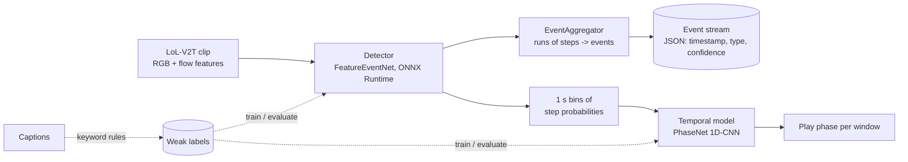

# Architecture and design decisions

## Pipeline

## Data: LoL-V2T and caption-derived labels

[LoL-V2T](https://tsunehiko.github.io/lol-v2t/) (Tanaka and Simo-Serra, CVPRW 2021): 9,723
League of Legends Worlds clips (76 h), 62,677 timestamped commentary sentences, split
6,977 / 851 / 1,895 clips (train / val / test). It is a video-captioning dataset. Two facts shape
the whole design:

1. **There are no event labels.** Labels come from the captions.
2. **There is no raw video.** The archives hold precomputed per-clip features
   (`<clip>_rgb.pkl`, `<clip>_flow.pkl`); Riot's policy keeps footage unpublished. Per the paper
   (section 5.1) the videos are down-sampled to one frame every 0.26 s and passed through TSN
   (built on mmaction2): two ResNet-50 networks pre-trained on Kinetics-400 *without fine-tuning*,
   one on RGB appearance and one on TVL1 optical flow. The one RGB file inspected is
   `(1, 109, 2048)`, i.e. ResNet-50's pooled 2048-d output; the flow file shape was not checked. No licence is stated on the dataset page, so the repo only downloads it
   (`data/scripts/download_lolv2t.py`) and never redistributes it.

## ADR-1: labels from captions (weak supervision)

Every sequence of frames gets its label from the commentary overlapping it. Keyword rules in
`common/lolv2t.py` map sentences to `kill`, `objective` (baron, dragon, herald, tower, inhibitor,
nexus) and `teamfight`. A sentence's event is stamped at the start of its segment and labels the
next 3 s of feature steps; where spans overlap, kill beats objective beats teamfight.

Consequences, stated plainly:

- Labels are noisy. Commentary lags the action, ASR text is imperfect, keywords miss events and
  fire on talk *about* events. Every metric here measures agreement with the commentary, not with
  what happened in the game.
- Step times assume feature steps are uniform over the clip duration. This is **not confirmed**:
  the paper samples one frame every 0.26 s, which would give about 91 steps for the one 23.6 s clip
  inspected, but the file has 109 (about 0.216 s per step). Until the discrepancy is explained
  (annotation duration vs. video length, or a different stride), event timestamps may be off by a
  few seconds, which is why evaluation uses a 3 s tolerance.
- A model can partly learn from the visual consequences of events (flow, scene change) and partly
  from commentary-correlated visual context. That is the point of the task but also why the numbers
  should not be read as game-event accuracy.

## ADR-2: per-step classifier + event aggregator

`FeatureEventNet` (`detection/model.py`) is a 1x1 projection plus four dilated residual 1D
convolutions (receptive field about 29 steps) and a per-step classifier over
`background | kill | objective | teamfight`. Feature mean and std are stored in the model as buffers,
so the exported ONNX normalises its own input. `EventAggregator` turns runs of identical step
predictions into one event stamped at the run start; `min_run` suppresses single-step blips. Events
are the schema `{timestamp, event_type, confidence, bbox?}`; `bbox` is unused here because features
carry no pixel geometry.

Training notes: class weights come from a sample of training clips (square-rooted, since the
background dominates); train features (about 11 GB) load lazily per batch; the checkpoint with the
best validation event macro-F1 is kept. Event metrics use a 3 s tolerance, because the labels
themselves are only accurate to the commentary's lag.

## ADR-3: temporal model = play-phase classification

*Option A from the plan:* classify sequences into higher-level plays. The detector's per-step
probabilities are averaged into 1 s bins; a 1D-CNN (`PhaseNet`) classifies each 6 s window
(stride 2 s) as `background | kill | objective | teamfight` where the label is again taken from the
captions (highest-priority event present in the window).

Two honest caveats:

- Inputs come from video features and labels from captions, but both the detector and this
  model are fit to the *same* keyword labels, so the temporal model mostly learns to denoise and
  smooth the detector. It is compared with a no-learning baseline (strongest mean event
  probability) so the gain, if any, is visible.
- To avoid training on over-clean detector outputs, it is trained on the detector's outputs for
  the **val** split (which the detector never fits, apart from checkpoint selection), with 20% of
  val clips held out for early stopping, and evaluated on the **test** split. The val split is
  small (851 clips), so the model is small too.
- Irregular-play / anomaly detection (in the original plan, Option B) is not done: nothing in
  LoL-V2T labels it.

## ADR-4: ONNX Runtime for serving, no PyTorch in the image

Both models export to ONNX with dynamic batch/length axes (`serving/onnx_export.py`, which also
checks ONNX output against PyTorch). The service depends on onnxruntime and numpy only. Session
threads are set to 1 intra-op so concurrency comes from the event loop and worker threads rather
than oversubscribing cores. TensorRT is the next step when a GPU is available.

## ADR-5: clip-level serving, micro-batching for the temporal model

The detector's convolutions use context on both sides and the features come from a clip-level
extractor, so the service takes a **clip's features** (`.npy`, `(T, D)`) rather than single frames:

- `POST /detect_features`: events.
- `POST /analyze`: events plus a play phase per window (the full pipeline).

Clips have different lengths, so detector calls run per request in a worker thread. The temporal
windows are fixed-length, so concurrent requests share one `MicroBatcher` (waits up to
`max_wait_ms`, default 3 ms, or `max_batch` windows, then one batched ONNX call). There is no
per-frame or streaming endpoint: it would need a feature extractor on raw video (the original
I3D-style network is not part of this repo) and a causal detector.

## Data splits

| Use | Split |
|---|---|
| Detector train / model selection / test | train / val / test |
| Temporal train and early stopping | val (detector outputs; 80/20 by clip) |
| Temporal test | test |

## Limitations

- Weak, keyword-derived labels; see ADR-1.
- No end-to-end raw-video path: inputs are LoL-V2T's precomputed TSN features, so the service
  cannot take new video without reproducing that extractor (ResNet-50, Kinetics-400, TVL1 flow).
- `bbox` is never filled; no spatial localisation.
- No irregular-play detection.
- Latency numbers (once measured) are CPU-only and use random features of the stated length.
