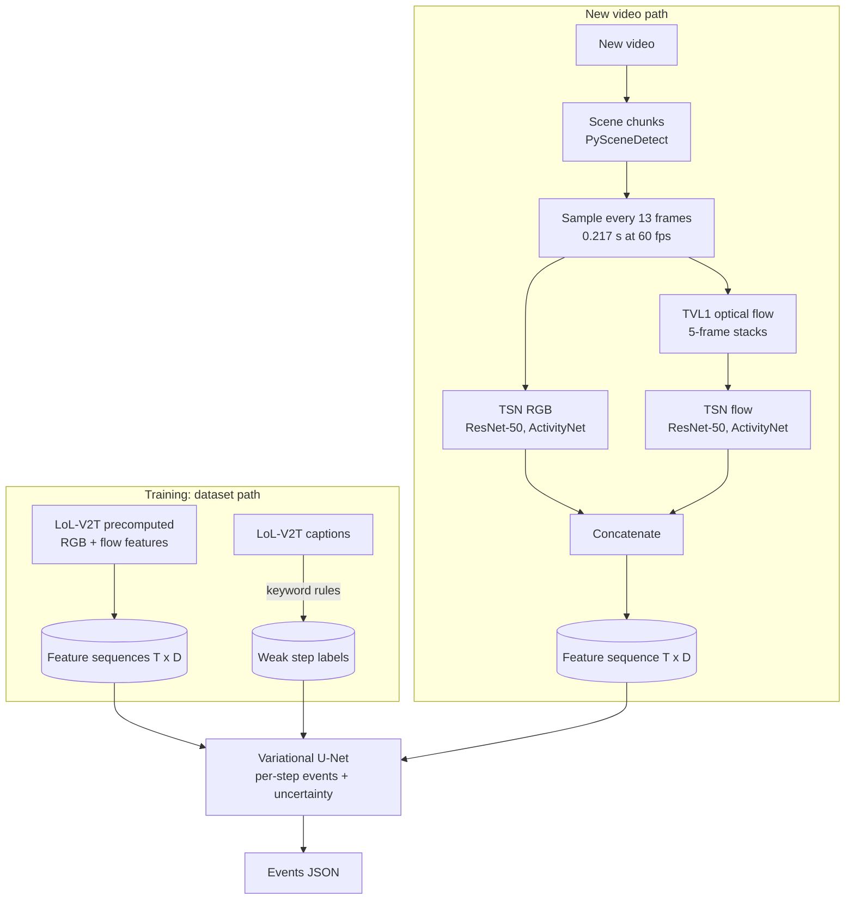

# Plan: reproducible feature extraction and a variational U-Net detector

Status: implemented in code (Steps 0-5); nothing trained, and the extractor's acceptance check
has not been run. Step 0's findings are in `feature_extraction.md` and corrected the diagram
below (13-frame step, ActivityNet checkpoints, scene chunking). Supersedes the earlier two-model
design (detector + temporal `PhaseNet`).

## Goals

1. A preprocessing module that reproduces the LoL-V2T feature extraction, so a new video yields
   the same kind of feature vector (RGB + optical flow) as the dataset.
2. One model, no temporal stage: a U-Net with a variational bottleneck that labels every time step
   of a clip.
3. A pipeline where training uses the dataset's precomputed features and a new video goes through
   preprocessing first.

## Corrections to settle first

- **109 is the number of time steps, not stacked frames.** Each step is one sampled frame turned
  into a 2048-number vector by ResNet-50. A clip is a `(T, D)` sequence of any length.
- **A VAE and a U-Net conflict if combined naively.** A VAE forces information through a small
  latent; U-Net skip connections bypass it, so the decoder can copy the input and ignore the
  latent. Design below avoids this.

## Pipeline

Training uses only the dataset path. The new-video path exists so inputs land in the same feature
space the model was trained on.

## Steps

### Step 0: read the source of truth

The dataset's own tool, `create-lol-v2t/dataset/feature_extraction.py` and `make_dataset.py`,
defines the exact process. Read it before writing any preprocessing. It settles what the paper
leaves open:

- which mmaction2 config and checkpoints are used, and which layer is read;
- how flow frames are stacked for the flow network;
- why a 23.6 s clip has 109 steps when 0.26 s sampling predicts about 91;
- how long videos are cut into clips (needed for the chunking stage).

### Step 1: preprocessing module (`preprocess/`)

- Sample one frame every 0.26 s (per the paper, section 5.1).
- TVL1 optical flow; TSN RGB and TSN flow ResNet-50 networks pre-trained on Kinetics-400 without
  fine-tuning; concatenate the two feature vectors as the dataset does.
- Use mmaction2 pinned to the dataset's version, in an optional install extra, because "the same
  features" means the same weights and code. A torchvision/ONNX port is a later optimisation.
- CLI: `python -m preprocess.extract video.mp4 --out features.npy`.
- **Acceptance test** (manual script, needs downloads): re-extract a few dataset clips from their
  YouTube videos and compare with the shipped features. Target: cosine similarity above 0.99 per
  step. This also resolves the 109-versus-91 question.
- Risks: videos may be unavailable or changed, so the check may only cover some clips; TVL1 flow
  is slow on CPU.

### Step 2: model (`detection/`)

Replace `FeatureEventNet` with a **U-Net with a variational bottleneck**, 1D over time:

- Encoder: 2-3 downsampling levels (strided convolutions); skip connections to the decoder.
- Bottleneck: outputs `mu` and `log_var`, samples `z`.
- **Classification head**: decoder with skips, outputs per-step logits
  (`background | kill | objective | teamfight`).
- **Reconstruction head**: rebuilds the input features from `z` only (no skips), so the latent
  must carry information.
- Loss = class-weighted cross-entropy (masked) + lambda * reconstruction MSE + beta * KL, with
  beta ramped up gradually.
- Variable-length clips are padded to a multiple of the downsampling factor; padding is masked
  out of every loss term.
- Uncertainty: sample `z` several times at inference; the spread in predictions is the
  uncertainty.
- Ablations: the same U-Net without the variational parts, and the existing dilated-conv net.
  If the VAE does not help, the results should say so.

Labels stay as they are: weak step labels from caption keywords (`common/lolv2t.py`).

### Step 3: remove the temporal model

Delete `temporal/`, `PhaseNet`, the `/analyze` phase output and the temporal micro-batcher.

### Step 4: serving and benchmarks

- Keep `POST /detect_features` (precomputed features).
- Add `POST /detect_video`: upload a video, run preprocessing, return events.
- Benchmark the model and the preprocessing separately. Preprocessing (TVL1 flow plus two
  ResNet-50 passes) will dominate, taking seconds per clip on CPU, so the low-latency claim
  applies to the model only. The README must say this.
- Two images: a slim features-only image (onnxruntime) and a full image with the extractor.

### Step 5: docs, tests, CI

- Update the README, `architecture.md` and the diagram above.
- Unit tests: model shapes, padding and masking, loss terms, label rules.
- Preprocessing test on a tiny fixture video (shapes, sampling times). The cosine-similarity
  check stays a manual script.

## Decisions

1. **Purpose of the VAE:** event detection together with uncertainty. The classification head
   predicts events; sampling `z` several times gives per-step predictive uncertainty.
2. **Extractor:** start with mmaction2 itself (same weights and code as the dataset), verified
   against the shipped features. A torchvision/ONNX port is optional later, and only if it passes
   the same cosine-similarity check.
3. **Long videos are cut into chunks**, as the dataset's tool does. Step 0 must establish how it
   cuts (chunk length, boundaries, any scene detection) so new chunks look like training clips.
   `preprocess/` gets a chunking stage ahead of frame sampling, and `/detect_video` returns events
   with timestamps offset to the full video.

4. **GPU is supported for training, extraction and serving.** Device is `auto` (GPU when
   available, else CPU), overridable with `device: cpu|cuda` in the training config, `--device` on
   the CLI, and the `DEVICE` environment variable for the service. CPU stays the default install.
   - Training and `Detector` (PyTorch): `common/device.py::torch_device`; model, batches and class
     weights move to the device, and outputs return to CPU before numpy.
   - ONNX serving: `onnx_providers` picks `CUDAExecutionProvider` when `onnxruntime-gpu` is
     installed, with CPU as fallback. `serving/Dockerfile.gpu` is the GPU image (`--gpus all`).
   - Preprocessing (Step 1) runs the two ResNet-50 networks on the same device. TVL1 flow needs
     OpenCV built with CUDA to use the GPU; otherwise it stays on CPU and remains the bottleneck.
   - `make install-gpu` installs the CUDA torch wheel (pick the index matching your driver).
   - Benchmarks (Step 4) must report CPU and GPU separately, and say which device each number is on.

## Constraints

Nothing here has been run, and the GPU paths are untested. Training and feature extraction need a
stronger machine than the development box.
